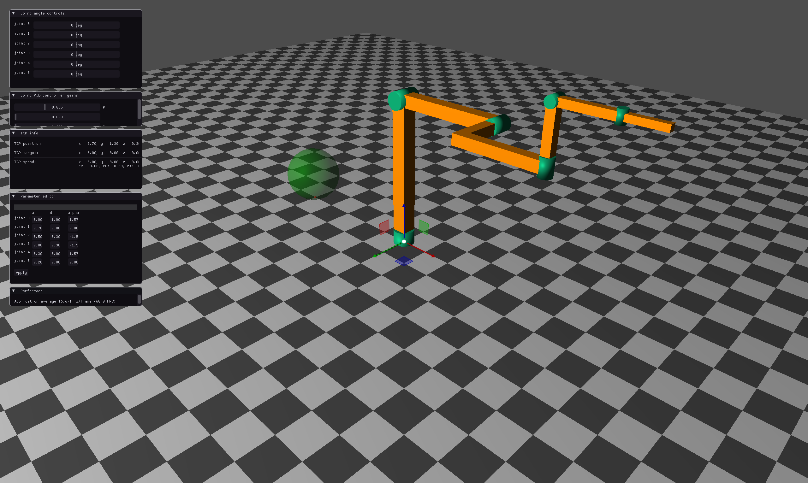
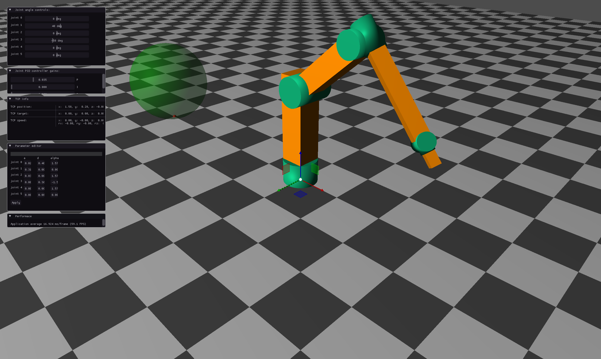
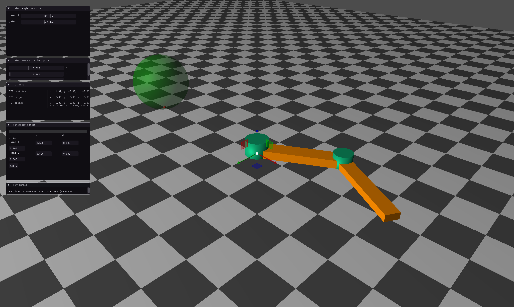
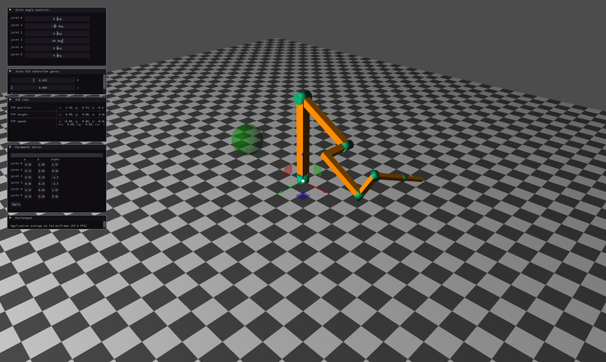
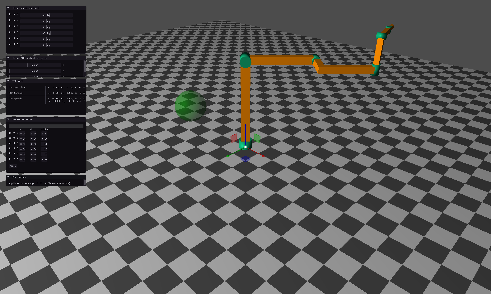

# RoboSim

A small C++17 / OpenGL simulator for serial robot arms. Describe an arm with Denavit–Hartenberg (DH) parameters, then drive its joints, edit its geometry live, solve inverse kinematics by clicking in the scene, and read the TCP pose/velocity and Jacobian in real time.



## Demo


## What you can do

- **Visualise any revolute serial arm** from a DH table (2 joints and up; the default is 6R).
- **Drive joints live** with sliders and watch TCP position, target and velocity update.
- **Edit links live** — change `a`, `d` and `alpha`, press *Apply*, and the procedural meshes are rebuilt.
- **Click to reach** — right-click in the 3D view sets an IK target for the numerical solver.
- **Inspect the kinematics** — TCP world position, linear/angular velocity and the manipulator Jacobian.
- **Free camera** — orbit, pan and zoom around the robot.

Good fits: teaching DH conventions and forward/inverse kinematics, prototyping link dimensions, and making figures for reports or lectures.

## Examples

Ready-to-run DH files live in [`examples/`](examples). All values are in metres and radians.

| Robot | Run | Notes |
|---|---|---|
| 6R industrial-style arm | `./robosim` or `./robosim examples/6r-industrial.txt` | Default robot, ~1.7 m reach |
| KUKA KR 6 class | `./robosim examples/kuka-kr6.txt` | Approximate DH, compact 6R |
| ABB IRB 120 class | `./robosim examples/abb-irb120.txt` | Approximate DH, small 6R |
| Planar 2R | `./robosim examples/planar-2r.txt` | Minimal teaching example |





### Same arm, different poses

The default arm driven to three configurations (joint angles in degrees, `joint 0 … joint 5`):

| Home — `0,0,0,0,0,0` | Reach — `0,-30,0,60,0,0` | Yaw + wrist — `45,0,0,60,0,0` |
|:---:|:---:|:---:|
|  |  |  |

`Ctrl+Click` a joint slider to type an exact angle, or start directly in a pose:

```bash
ROBOSIM_ANGLES="0,-30,0,60,0,0" ./robosim
```

## Installation

You need a C++17 compiler, CMake ≥ 3.26, OpenGL 3.3+, GLFW 3.3+ and GLEW 2.x. Eigen, Dear ImGui and ImGuizmo are vendored in `lib/`, so they need no download.

**Ubuntu / Debian**
```bash
sudo apt install build-essential cmake libglfw3-dev libglew-dev libgl1-mesa-dev
```

**Fedora**
```bash
sudo dnf install gcc-c++ cmake make glfw-devel glew-devel mesa-libGL-devel
```

**macOS** (Homebrew; install the Xcode command line tools first if needed)
```bash
xcode-select --install
brew install cmake glfw glew
```

**Windows** — install GLFW and GLEW with [vcpkg](https://vcpkg.io):
```powershell
vcpkg install glfw3 glew
```
Then configure with the vcpkg toolchain (see below) from a *Developer PowerShell*.

## Building

```bash
cmake -S . -B build -DCMAKE_BUILD_TYPE=Release
cmake --build build -j
```

On Windows add `-DCMAKE_TOOLCHAIN_FILE=<vcpkg-root>/scripts/buildsystems/vcpkg.cmake` to the configure command and build with `cmake --build build --config Release`.

The executable is written to the project root.

## Running

Run from the repository root — shaders and the default parameter file are loaded by relative path.

```bash
./robosim                              # default 6R arm
./robosim examples/kuka-kr6.txt        # any DH file
./robosim --help
```

Optional environment variables:

| Variable | Example | Purpose |
|---|---|---|
| `ROBOSIM_ANGLES` | `"0,-30,0,60,0,0"` | Initial joint angles in degrees |
| `ROBOSIM_CAMERA_RADIUS` | `1.8` | Camera distance (useful for very small or large arms) |

## DH parameter file format

One joint per line; blank lines and `#` comments are ignored.

```
# sigma  a      d     alpha   theta
R        0.7    0     0       x
R        0.5    0.3   -pi/2   x
```

| Field | Meaning |
|---|---|
| `sigma` | `R` for revolute. (`P` is parsed but prismatic joints are not simulated yet.) |
| `a` | Link length |
| `d` | Link offset |
| `alpha` | Link twist; accepts `pi/2`, `-pi/2`, `pi`, or plain numbers |
| `theta` | Ignored for `R` — it is the joint variable |

## Controls

| Input | Action |
|---|---|
| Middle drag | Orbit |
| Shift + middle drag | Pan |
| Scroll | Zoom |
| Right click | Set IK target |
| Ctrl + click slider | Type an exact joint angle |

On Wayland the app starts through XWayland (`GLFW_PLATFORM_X11`), because GLEW uses the GLX loader.

## Project layout

```
src/        application, robot model, kinematics, meshes, rendering
lib/        vendored Eigen, Dear ImGui, ImGuizmo
examples/   ready-to-run DH parameter files
doc/        screenshots and a detailed walkthrough
```

For the maths and a code walkthrough, see [README_COMPREHENSIVE.md](README_COMPREHENSIVE.md).

